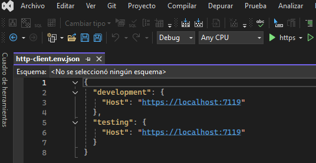
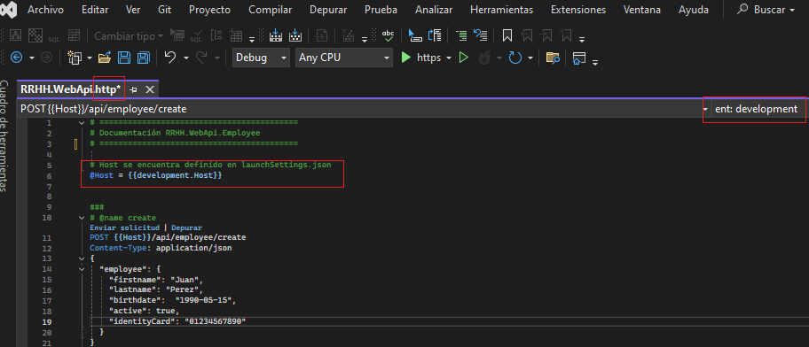

# ASP.NET Core Web API - Clean Architecture & Agnostic Persistence

<div style="text-align: justify;">
Este repositorio contiene una solución desarrollada en <strong>.NET 8</strong> implementando <strong>Clean Architecture</strong>. El objetivo principal de este proyecto es demostrar un desacoplamiento real y extremo, donde el núcleo del negocio (<strong>Core</strong>) es completamente inmune a los cambios de infraestructura, proveedores de persistencia o motores de bases de datos.
</div>

 
## 🏗️ Arquitectura de la Solución

La solución está dividida estrictamente siguiendo los principios de diseño de **Clean Architecture** e **Inversión de Dependencias (IoC)**:

* <div style="text-align: justify;">
  <strong>Core.Domain & Core.Application:</strong>  Esta capa es 100% agnóstica; no posee referencias a paquetes de persistencia, ORMs ni anotaciones de infraestructura.<br>
 
    * <strong>Core.Application</strong>, contiene los DTOs e Interfaces (Contratos) de los Servicios(implementan las Reglas del Negocio)<br>
    * <strong>Core.Domain</strong>, contiene la implementación de los Servicios
  </div><br>
 
* <div style="text-align: justify;">
  <strong>Infrastructure.Persistence:</strong> Aquí se confinan de forma estricta las entidades de base de datos, los contextos de los ORMs y las implementaciones de los Repositorios. El Core solo se comunica con esta capa a través de abstracciones.
  </div><br>

* <div style="text-align: justify;">
  <strong>Presentation (Web API):</strong> Expone los endpoints REST y gestiona los payloads de entrada.<br>
 </div><br>
 
 
## ⚡ Características Clave y Desacoplamiento Técnico

### 1. Enfoque Database-First 
<div style="text-align: justify;">
A diferencia de los enfoques Code-First tradicionales que suelen contaminar el dominio con metadatos de persistencia, en este proyecto las bases de datos fue modelada directamente desde herramientas nativas (<strong>SSMS</strong>, <strong>Oracle SQL Developer</strong>, etc.). Toda la generación de código de infraestructura y mapeo quedó estrictamente encapsulada en <strong>Infrastructure.Persistence</strong>.
</div>

### 2. Intercambiabilidad de Persistencia 
<div style="text-align: justify;">
Gracias al uso de contratos e inyección de dependencias, la aplicación está diseñada para alternar su infraestructura de acceso a datos sin modificar una sola línea de código en las capas de aplicación o API. La arquitectura permite intercambiar:  

 * <strong>Proveedores de Acceso:</strong> Pasar de un enfoque de alto nivel con <strong>Entity Framework Core</strong> a consultas de bajo nivel altamente optimizadas con <strong>ADO.NET</strong>.<br>
 * <strong>Motores de Base de Datos:</strong> Compatibilidad nativa e intercambiable entre <strong>SQL Server, Oracle,MySQL, PostgreSQL e IBM Db2</strong>.
</div>

### 3. Validación Temprana y Eficiente
<div style="text-align: justify;">
Implementando la validación sintáctica de integridad de datos mediante <strong>DataAnnotations</strong> directamente en los DTOs de la capa <strong>Core.Application</strong>. Permite que ASP.NET Core intercepte y rechace payloads inválidos de forma automática con un <strong>400 Bad Request</strong>, evitando el consumo innecesario de recursos en la lógica de negocio.
</div> 

### 4. Automatización y Testing Liviano
<div style="text-align: justify;">
Eliminé la dependencia de herramientas externas pesadas para la documentación y prueba de los endpoints:

* <strong>Pruebas Integradas:</strong> Testing de la API documentado y ejecutable directamente desde el IDE mediante archivos <strong>.http</strong>.
<br>
* <strong>Gestión de Entornos:</strong> Configuración dinámica de variables de entorno (Desarrollo, QA, Producción) a través de archivos <strong>.env</strong>.<br>
* <strong>Fácil Configuración:</strong> Cualquier desarrollador puede clonar el repositorio y probar los <strong>endpoints</strong> con un solo clic de forma inmediata.

#### Archivo de Configuración .env


#### Ejemplo de Configuración archivo .http  


</div><br>


## 🛠️ Tecnologías

*   **Lenguaje:** C# (.NET  8)
*   **Framework Principal:** ASP.NET Core Web API
*   **Acceso a Datos:** Entity Framework Core / ADO.NET
*   **Motores Soportados:** SQL Server, Oracle, MySQL,  PostgreSQL, IBM Db2
*   **Herramientas de Productividad:** .http files, .env configuration
<br>
<br>

 
### 🗺️ Mapa de Dependencias de la Solución
```bash
Solución: DemoRRHH.sln
│
├── 📁 01_Presentation
│   └── 💻 WebAPI.csproj
│       └── 📄 Referencias:
│           ├── 🔀 Core.Application.DTO
│           ├── 🔀 Core.Application.Interfaces.Services
│           └── 🔀 Core.Domain.Services
│
├── 📁 02_Core
│   ├── 📦 Core.Application.DTO.csproj
│   │   └── 📄 Referencias: (Ninguna de la presente Solución)
│   │
│   ├── 📦 Core.Application.Interfaces.Repository.csproj
│   │   └── 📄 Referencias:
│   │       └── 🔀 Core.Application.DTO
│   │
│   ├── 📦 Core.Application.Interfaces.Services.csproj
│   │   └── 📄 Referencias:
│   │       ├── 🔀 Core.Application.DTO
│   │       └── 🔀 Core.Application.Interfaces.Repository
│   │
│   └── 📦 Core.Domain.Services.csproj
│       └── 📄 Referencias:
│           ├── 🔀 Core.Application.DTO
│           ├── 🔀 Core.Application.Interfaces.Services
│           └── 🔀 Core.Application.Interfaces.Repository
│
└── 📁 03_Infrastructure
    └── ⚙️ Infrastructure.Persistence.csproj
        └── 📄 Referencias:
            ├── 🔀 Core.Application.DTO
            ├── 🔀 Core.Application.Interfaces.Repository
            │
            └── 🛠️ Motores y ORMs
                ├──  Entity Framework Core ──> SQL Server, Oracle
                └──  ADO.NET ──> SQL Server, Oracle, MySQL, IBM Db2
                                 PostgreSQL


```

 


